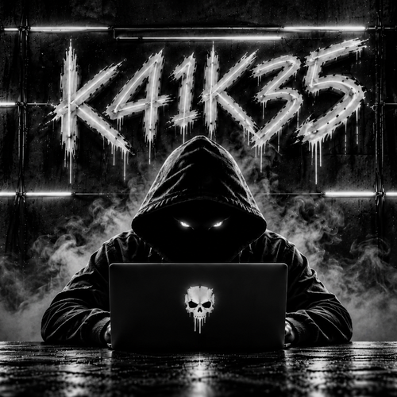

# 🐬 Flipper Control

<p align="center">
  
</p>

<p align="center">
  <b>Control Remoto de Flipper Zero para iOS (SwiftUI & CoreBluetooth)</b><br>
  <sub>Desarrollado y mantenido por <b>K41K35</b></sub>
</p>

---

## 📌 Descripción del Proyecto

**Flipper Control** es una aplicación cliente para iPhone (iOS 17+) diseñada para interactuar con **Flipper Zero** mediante Bluetooth Low Energy (BLE). Incorpora una interfaz nativa en SwiftUI con modo oscuro y comunicación directa utilizando el protocolo Protobuf RPC oficial sobre CoreBluetooth.

### 🚀 Capacidades Principales
- 📡 **Enlace BLE Robusto**: Reconexión automática con soporte para restauración de estado en segundo plano (`bluetooth-central`).
- 📺 **Streaming de Pantalla**: Visualización en tiempo real del display monocromo (128x64) a través del canal RPC.
- 🕹️ **Control Remoto y Virtual D-Pad**: Control interactivo completo replicando los controles físicos del dispositivo.
- 📡 **Infrarrojos Universal (IR)**:
  - Navegación y emisión de señales desde las bibliotecas estándar (`/ext/infrared/assets`).
  - Organización de mandos personalizados en `/ext/infrared/FlipperControl`.
  - Gestión de favoritos y agrupaciones temáticas.
- 📻 **Sub-GHz**: Exploración y ejecución directa de aplicaciones Sub-GHz.
- 📊 **Diagnóstico Integrado**: Registro local de eventos y telemetría de conexión en `FlipperControl-diagnostico.log`.

---

## 📂 Estructura del Repositorio

```text
FlipperControl/
├── .github/
│   └── workflows/
│       └── flipper-control-ipa.yml      # Integración continua para generar IPA en macOS
├── assets/
│   └── avatar.png                      # Identidad gráfica
├── Flipper Zero/
│   └── FlipperControl-iOS/             # Proyecto nativo iOS (SwiftUI + XcodeGen)
│       ├── FlipperControl/             # Fuentes Swift (BLE, Protobuf, UI, Modelos)
│       ├── Tests/                      # Tests unitarios del protocolo (ProtoWire, UniversalIR)
│       ├── Assets.xcassets/            # Recursos y AppIcon
│       ├── build_ipa_macos.sh          # Script de compilación local automatizada
│       ├── project.yml                 # Especificación de proyecto XcodeGen
│       └── README.md                   # Documentación técnica específica
├── .gitignore                          # Reglas de exclusión para Git y Xcode
└── README.md                           # Documentación principal
```

---

## 🛠️ Compilación e Instalación

### 1. Compilación Local (macOS con Xcode)
Se requiere tener instalados Xcode y XcodeGen:
```bash
brew install xcodegen
cd "Flipper Zero/FlipperControl-iOS"
./build_ipa_macos.sh
```
El script generará el artefacto IPA sin firmar en `build/FlipperControl-unsigned.ipa`.

### 2. Compilación Automatizada en GitHub Actions
El repositorio incluye un flujo de trabajo CI (`.github/workflows/flipper-control-ipa.yml`) que compila la aplicación en runners macOS y publica la IPA lista para descarga como artefacto de compilación.

### 3. Instalación en iPhone
Para instalar la aplicación:
1. Firma el archivo IPA con tu perfil de aprovisionamiento o herramienta de firma preferida (TrollStore, AltStore, Sideloadly o Xcode).
2. Bundle ID configurado por defecto: `es.k41k35.FlipperControl`.
3. Empareja por Bluetooth con tu Flipper Zero directamente desde la aplicación.

---

## 👤 Autor

- **Desarrollador**: **K41K35**

---

> [!NOTE]
> Este proyecto es un cliente independiente desarrollado para la comunidad y no está afiliado ni respaldado por Flipper Devices Inc.
